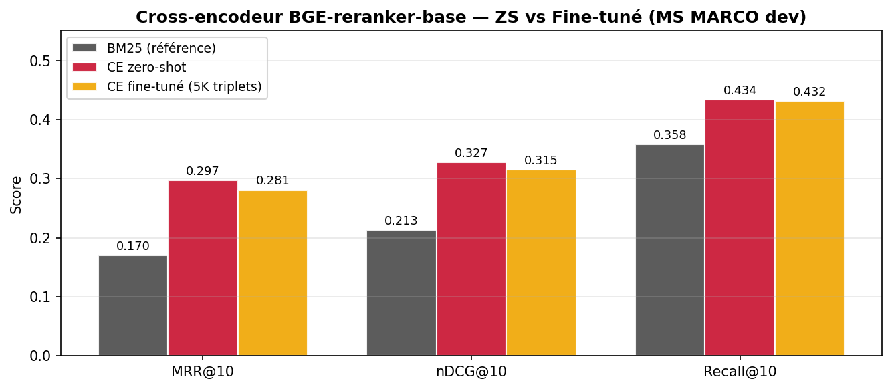
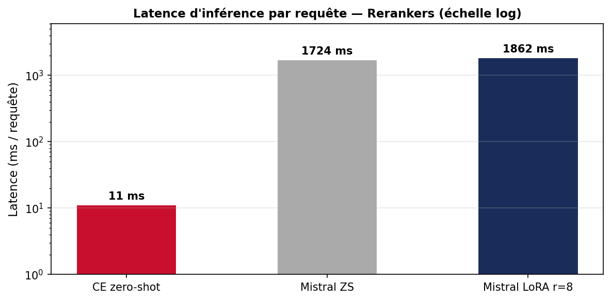

# Neural Passage Retrieval on MS MARCO

A modular retrieve-then-rerank pipeline for passage search, built to compare
lexical, dense, distilled, cross-encoder and LLM-based rankers under a tight
compute budget (one shared GPU, time-limited SLURM jobs).

Given a natural-language question, the system must return the passages of the
[MS MARCO Passage Ranking](https://microsoft.github.io/msmarco/) collection
(8.8M passages) that answer it. Every component implements the same interface
and writes the same evaluation artifacts, so systems can be swapped, stacked
and compared.

| Stage | System | Implementation |
| :--- | :--- | :--- |
| First stage | BM25 | `bm25s` index over the full collection |
| First stage | Dense bi-encoder | BGE (zero-shot and fine-tuned), exact inner-product search |
| First stage | **BM25 → BGE-small pairwise distillation** | custom PyTorch training loop on teacher preference pairs |
| Reranking | Cross-encoder | `BAAI/bge-reranker-base`, zero-shot and fine-tuned |
| Reranking | LLM reranker | Mistral-7B-Instruct with QLoRA, yes/no logit scoring, LoRA-rank ablation |
| Fusion | Reciprocal Rank Fusion | standard and weighted RRF, ablation on `k` |

## Main results

### Reranking — same candidates, directly comparable

All rerankers reorder the **same BM25 top-20** candidates on the 6,980 queries
of the MS MARCO dev set. BM25's Recall@20 (0.437) is the ceiling for Recall@10.

| Reranker | MRR@10 | nDCG@10 | Recall@10 | Latency (ms / query) |
| :--- | ---: | ---: | ---: | ---: |
| BM25 (no reranking) | 0.170 | 0.213 | 0.356 | – |
| **BGE cross-encoder, zero-shot** | **0.297** | **0.327** | **0.434** | **11** |
| BGE cross-encoder, fine-tuned (5k triplets) | 0.281 | 0.315 | 0.432 | 11 |
| Mistral-7B, zero-shot | 0.204 | 0.246 | 0.384 | 1,724 |
| Mistral-7B + LoRA (r = 8, 10k examples) | 0.275 | 0.310 | 0.427 | 1,862 |

- A small pretrained cross-encoder is the best reranker **and** about 166×
  cheaper per query than the 7B LLM.
- LoRA fine-tuning lifts Mistral from 0.204 to 0.275 MRR@10, but not past the
  cross-encoder. Ranks 4 and 16 reach 0.268 and 0.270 on a 500-query subset;
  the adapter rank is not the bottleneck at this data scale.
- Lightly fine-tuning the cross-encoder (5k triplets, one epoch) slightly
  *hurts* it: with so little data and no hard negatives, supervision mostly
  adds noise to a model already trained for ranking.

<p align="center">
  
  
</p>

### First-stage retrieval — exploratory, protocols differ

Compute limits forced several dense runs onto sub-corpora, so the rows below
are **not** a leaderboard: each one is only comparable to systems evaluated on
the same corpus and queries.

| Retriever | MRR@10 | Recall@100 | Protocol |
| :--- | ---: | ---: | :--- |
| BM25 | 0.170 | 0.617 | 6,980 queries, full collection (8.8M) |
| BGE-large, zero-shot | 0.257 | 0.383 | 2,094 queries, 30% of the collection |
| BGE-base, fine-tuned on 20k pairs | 0.066 | 0.102 | 6,980 queries, 10% of the collection |
| BGE-small distilled from BM25 | 0.264 | 0.561 | 412 queries, 10% relevance-aware sub-corpus |

- BM25 remains the most robust first stage in the hardest setting (full
  collection, all dev queries).
- Fine-tuning BGE-base on 20k in-batch pairs collapses it — an
  under-training failure that also makes it useless for fusion: RRF of BM25
  with this run peaks at 0.110 MRR@10 (`k = 30`), below BM25 alone, and a grid
  search over fusion weights converges to ignoring the dense run.

## Pairwise distillation from a lexical teacher

`src/retrieval/pairdistill/` adapts the idea of
[PairDistill](https://aclanthology.org/2024.emnlp-main.1013/) — distilling *pairwise*
preferences rather than pointwise scores — to a setting with no neural teacher:
BM25 rankings supervise a compact dense student (`BAAI/bge-small-en-v1.5`,
33M parameters).

1. **Teacher signal.** BM25 retrieves the top 100 passages for each training
   query; rankings are cached.
2. **Preference pairs.** A preferred passage is drawn from the teacher's top
   10 and a comparison passage from rank 20 onward, subject to a minimum rank
   gap and score gap so that near-ties are not turned into labels.
3. **Objective.** With student scores `s(q, d) = <e_q, e_d>` on normalised
   embeddings, the student margin `Δ_S = s(q, d+) − s(q, d−)` is trained with a
   soft-label binary cross-entropy against the teacher's confidence:

   ```
   L = BCEWithLogits(Δ_S / τ_S,  σ(Δ_T / τ_T)),   Δ_T = BM25(q, d+) − BM25(q, d−)
   ```

   so that large BM25 gaps give confident targets and small ones give soft
   targets (`τ_T = 5`, `τ_S = 1`).
4. **Evaluation.** The trained student encodes the corpus and is searched by
   exact inner product (FAISS, with a NumPy fallback).

**Run reported above:** 10,000 training queries → 39,983 pairs, 2 epochs,
batch size 16, learning rate 2e-5; pairs come from the *train* split and
evaluation uses the *dev* split. Training loss goes from 0.643 to 0.624;
the student reaches MRR@10 0.264 / nDCG@10 0.291 / Recall@100 0.561.

**What this result does and does not show.** The sub-corpus is
*relevance-aware*: a naive "first N passages" truncation removes almost every
judged passage and yields metrics of zero, so judged passages are kept first
and the corpus is then filled to 884k passages. This makes the task easier than
full-collection retrieval, and the 412 retained dev queries are a small sample.
The run shows that the pipeline learns a usable ranking signal from a purely
lexical teacher; it does not yet establish a gain over the pretrained student
or over BM25, since neither was evaluated on this exact sub-corpus. An earlier
exploratory run that drew its training pairs from the dev split is kept in
`results/pairdistill_bm25_100k_fixed/` for the record and is **not** a valid
held-out number.

## Repository layout

```
src/
  data/           MS MARCO download, BEIR-format loaders, sub-corpus sampling
  retrieval/
    bm25/         bm25s index and retriever
    dense/        bi-encoder retriever with cached embeddings
    pairdistill/  pair construction, distillation trainer, student retriever
    cross_encoder/  cross-encoder reranker and training data
    reranker/     Mistral-7B QLoRA reranker
    hybrid/       Reciprocal Rank Fusion
  evaluation/     MRR@k, nDCG@k, Recall@k and run serialisation
scripts/          training / evaluation entry points and SLURM job templates
notebooks/        analysis notebooks that produce the figures
results/          metrics, configs, per-query scores, qualitative examples, figures
tests/            unit tests (metrics, pair construction, fusion)
```

Every retriever returns `{qid: [(pid, score), ...]}` and every run directory
contains `config.json`, `metrics.json`, `per_query_metrics.json` and
`qualitative_examples.json`.

## Usage

```bash
python -m venv .venv && source .venv/bin/activate
pip install -r requirements.txt
cp .env.example .env          # Hugging Face token, needed for Mistral-7B only

# BM25 baseline (downloads MS MARCO and builds the index on first use)
python scripts/run_bm25_eval.py

# Pairwise distillation: quick end-to-end check, then the 10% run
python scripts/run_pairdistill_bm25.py --max-corpus 5000 --max-train-queries 100 \
    --max-eval-queries 100 --epochs 1 --teacher-top-k 50 --top-k 50
python scripts/run_pairdistill_bm25.py --max-corpus 884000 --max-train-queries 10000 \
    --max-eval-queries 500 --epochs 2 --batch-size 16 --device cuda

# Rerankers on the BM25 top-20
python scripts/cross_encoder/eval.py --model BAAI/bge-reranker-base --top_k_first 20
python scripts/reranker/train.py --lora_rank 8
python scripts/reranker/eval.py --lora_rank 8 --top_k_first 20 \
    --adapter_path results/mistral/training/mistral_lora_r8/best_checkpoint

# Fusion of two saved runs
python scripts/run_rrf_eval.py --bm25-run <bm25 run.json> --dense-run <dense run.json>

# Tests
pip install pytest && python -m pytest tests
```

The `scripts/*/submit_*_slurm.sh` files are job templates; set the account,
partition and modules for your cluster. Model weights, indexes and full run
files are not versioned and are regenerated by the scripts.

## Limitations and next steps

- **One protocol for all first-stage systems.** Evaluate BM25, the pretrained
  BGE-small and the distilled student on the same sub-corpus and queries, to
  measure what distillation actually changes.
- **A stronger teacher.** Replace BM25 with the cross-encoder, which is the
  best ranker here and the setting PairDistill was designed for; BM25 can then
  serve only as the candidate generator.
- **Hard negatives and more data** for the bi-encoder and cross-encoder
  fine-tuning runs, which are under-trained.
- **Fusion with competitive dense runs.** RRF was only tested with the degraded
  BGE-base run; BM25 + distilled student is the natural experiment.
- **Annotation sparsity.** MS MARCO has about one judged passage per query;
  several "errors" of the rerankers are unjudged paraphrases of the answer
  (see `qualitative_examples.json` in each run).

## References

- Nguyen et al., *MS MARCO: A Human Generated MAchine Reading COmprehension Dataset*, 2016.
- Robertson and Zaragoza, *The Probabilistic Relevance Framework: BM25 and Beyond*, 2009.
- Xiao et al., *C-Pack: Packaged Resources To Advance General Chinese Embedding* (BGE), 2023.
- Huang and Chen, *PairDistill: Pairwise Relevance Distillation for Dense Retrieval*, EMNLP 2024.
- Hinton, Vinyals and Dean, *Distilling the Knowledge in a Neural Network*, 2015.
- Nogueira and Cho, *Passage Re-ranking with BERT*, 2019.
- Dettmers et al., *QLoRA: Efficient Finetuning of Quantized LLMs*, 2023.
- Cormack, Clarke and Büttcher, *Reciprocal Rank Fusion Outperforms Condorcet and Individual Rank Learning Methods*, SIGIR 2009.
